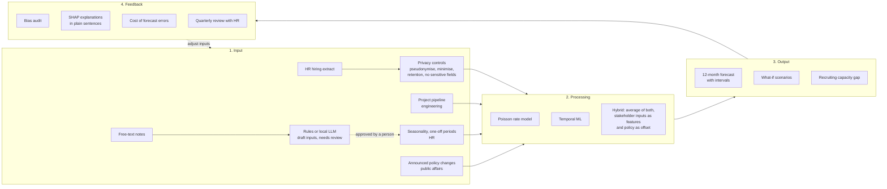
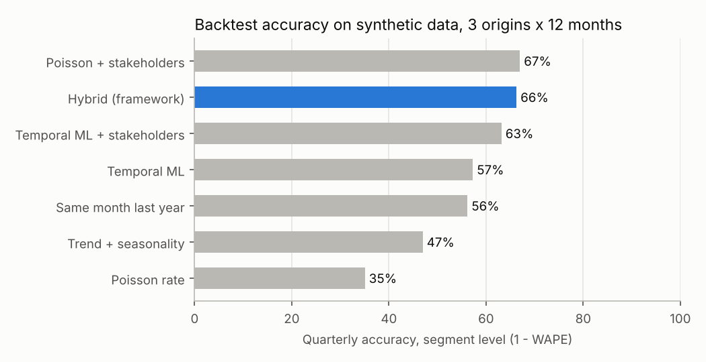
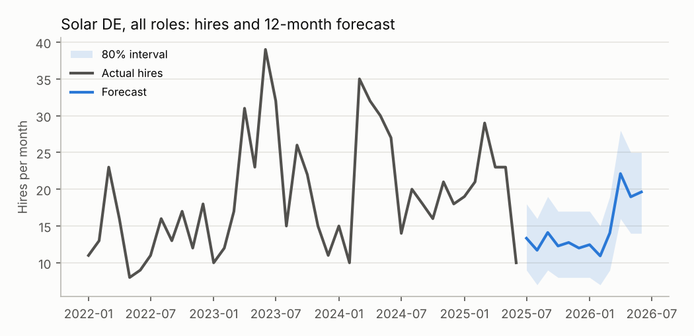

# GenAI workforce demand forecasting framework

A working version of the framework from my M.Sc. Data Analytics thesis (Berlin School of Business and Innovation, 2025):
*Developing a conceptual framework for leveraging GenAI in workforce demand forecasting*. The thesis was a corporate-sponsored case study with a renewable energy company in Germany.

This repository is the public version. It contains the framework, a synthetic data set built to show the same problems, and code that runs end to end. It contains **no company data, no interview data and none of the thesis results**. Every number below comes from synthetic data.

## The problem

Hiring in renewable energy follows projects, not a steady trend. A solar park moves into construction and needs field technicians for six months. A subsidy changes and project starts jump a quarter later. A permitting reform adds admin work. Most forecasting tools assume the future looks like the past, and the past here was also distorted by a hiring backlog after COVID.

The thesis asked how a forecasting framework can handle this, while staying fair and inside GDPR/BDSG. The answer was to combine statistical and machine learning models with structured input from the people who know what is coming: HR, engineering and policy teams.

## The framework



More detail, including the theory behind it (Resource-Based View, Task-Technology Fit) and the risk matrix: [docs/framework.md](docs/framework.md).

## Results on synthetic data

Rolling-origin backtest with three origins (Jan, Apr and Jul 2024), each forecasting 12 months ahead. A model only sees data from before its origin.

| Model | Monthly accuracy | Quarterly accuracy | Division, quarterly | MAE (roles per quarter) | Bias |
|---|---|---|---|---|---|
| Poisson + stakeholder inputs | 49.2% | 67.0% | 81.5% | 3.75 | -3.4% |
| **Hybrid (framework)** | **48.5%** | **66.3%** | **80.1%** | **3.83** | **-8.0%** |
| Temporal ML + stakeholder inputs | 45.3% | 63.2% | 77.5% | 4.18 | -12.6% |
| Temporal ML, history only | 39.9% | 57.3% | 72.7% | 4.85 | -13.2% |
| Same month last year | 33.7% | 56.2% | 74.6% | 4.97 | -3.3% |
| Trend + seasonality (Greykite-style) | 33.2% | 47.0% | 65.4% | 6.02 | +3.2% |
| Poisson rate (no inputs) | 22.1% | 35.1% | 52.8% | 7.38 | +26.3% |

Accuracy is 1 - WAPE. Monthly and quarterly figures are per segment (technology x country x role family, 16 segments). Division adds up all roles per technology and country, the level most hiring plans are made at.



What I take from this:

* **Stakeholder input is what helps the most.** The same temporal model goes from 57% to 63% quarterly accuracy when it gets the project pipeline, HR seasonality and policy calendar. The hybrid reaches 66%.
* **The hybrid is not the single best model on this data.** The Poisson model with stakeholder inputs scored slightly higher. I kept the hybrid as the framework model because its two parts fail in different ways: trees cannot extrapolate when the pipeline grows past anything seen before, and the Poisson model cannot pick up patterns it was not given. With real data, the backtest decides.
* **Monthly accuracy per segment is low for every model.** Most segments hire 1 to 5 people a month, and at that size random variation alone takes away a large share of accuracy. Plans should be read at quarter and division level.
* **Trend models over-forecast technical roles.** The history contains a post-COVID hiring wave. Trend + seasonality over-forecasts technicians by 16% and the plain Poisson model by 53%. With HR marking the wave as a one-off, the hybrid is within 1%. The thesis saw the same pattern.
* **The bias audit flags admin and project manager roles for every model** (about -30%). In 2024 these small groups hired more than their expected rate. The audit is there to catch exactly this and send it to the quarterly review. I did not tune it away.

Full report with all tables: [reports/forecast_report.md](reports/forecast_report.md).

### Forecast and explanation



In the thesis, most HR stakeholders found model output hard to follow. Each forecast therefore comes with SHAP values turned into sentences, for example:

> solar DE technician, 2025-09: project pipeline in the target month raises it by about 113%; hires three months ago lowers it by about 32%; role family lowers it by about 22%.

## Where GenAI is used, and where it is not

The thesis framed the whole model as GenAI. In this version I am more precise:

* **Forecasting** uses a Poisson regression and a gradient-boosted temporal model. The thesis described a transformer. With 16 segments and three and a half years of monthly data, a transformer would overfit and could not be explained exactly. A gradient-boosted model with a Poisson loss trains in seconds and SHAP explains it exactly.
* **Stakeholder notes** are where GenAI fits. The thesis recommended NLP to process stakeholder feedback, because typing it into the model by hand did not scale. `parse-notes --llm` sends each note to a local model through [Ollama](https://ollama.com), so no text leaves the machine. The output is validated against a fixed schema and saved as a draft with status `needs_review`. A rule-based parser does the same job offline and is used in CI. Nothing from a note reaches the forecast until a person approves it in `config/stakeholder_inputs.yaml`.

## Privacy and fairness

| Control | Where |
|---|---|
| Direct identifiers (email, employee ID) dropped; IDs replaced by salted hashes | `privacy.prepare_hr_extract` |
| Only six columns reach the model; gender is kept apart for the aggregated audit | `privacy.MODEL_COLUMNS` |
| Records older than the retention period are removed | `config/default.yaml` → `retention_months` |
| Groups below 10 people are suppressed in shared tables | `privacy.suppress_small_cells` |
| Forecast bias by role family checked every run | `fairness.forecast_bias` |
| Past hiring compared with diversity targets, aggregated only | `fairness.representation` |
| Every stakeholder input has a source and an approval status | `config/stakeholder_inputs.yaml` |

The forecast works at segment level and never scores individuals. Governance proposals from the thesis (AI ethics board, quarterly bias audits, AI literacy for HR) are in [docs/governance.md](docs/governance.md).

## Run it

```bash
pip install -e ".[dev]"
python -m workforce_forecast generate-data   # writes data/synthetic/
python -m workforce_forecast run             # backtest, forecast, audits, report
python -m workforce_forecast parse-notes     # stakeholder notes -> draft inputs
python -m workforce_forecast parse-notes --llm   # same, with a local Ollama model
pytest
```

The full run takes under a minute on a laptop. Outputs go to `outputs/` (CSV) and `reports/` (markdown and charts).

## Repository layout

```
config/            assumptions, stakeholder inputs, example stakeholder notes
data/synthetic/    generated HR extract and project pipeline (no real data)
src/workforce_forecast/
    synthetic.py   data generator
    privacy.py     GDPR/BDSG controls
    stakeholder.py structured inputs, note parser (rules or local LLM)
    features.py    input layer: features for the direct multi-horizon model
    models.py      processing layer: baselines, temporal ML, Poisson, hybrid
    evaluation.py  rolling-origin backtest and metrics
    fairness.py    forecast bias and representation audits
    explain.py     SHAP and plain-language explanations
    scenarios.py   intervals, what-if scenarios, recruiting gap
    cost.py        cost of forecast errors
    pipeline.py    runs everything and writes the report
docs/              framework, governance, thesis summary, data dictionary
outputs/, reports/ results of the last run
tests/             27 tests
```

## Limitations

* The data is synthetic. It was built to have the problems described in the thesis, so the models are tested on problems I put there. Real data will be messier.
* Policy effects are entered as a single expected percentage. Real policy effects are uncertain and the scenarios only partly cover that.
* The intervals cover random variation in hiring, not model error.
* The cost estimate depends on three assumed figures in the config. Change them before using the result.

## Thesis

Chaubay, P. (2025). *Developing a conceptual framework for leveraging GenAI in workforce demand forecasting: A case study in the renewable energy sector.* M.Sc. Data Analytics, Berlin School of Business and Innovation. A summary of the research and how this repository relates to it: [docs/thesis-summary.md](docs/thesis-summary.md).

## License

MIT
